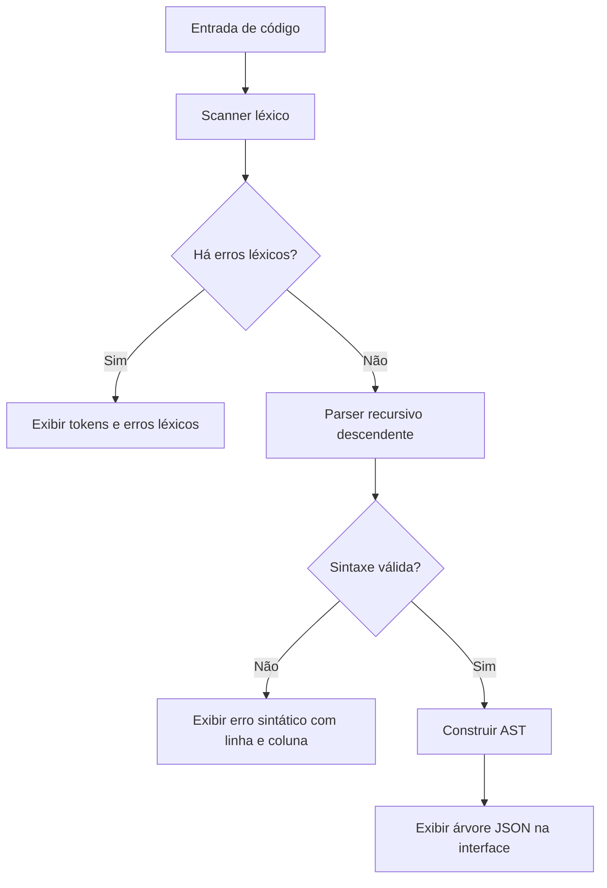

# Materiais e métodos — LexiPy Etapa 4

## Delineamento
Desenvolvimento incremental de um recurso didático para apresentar a transição entre análise léxica e análise sintática de um subconjunto de Python. A implementação mantém o scanner da Etapa 3 e adiciona um parser recursivo descendente, construção de AST e diagnósticos.

## Materiais
- Python 3.12.
- FastAPI e Pydantic para a API.
- Biblioteca padrão `tokenize` para obter tokens estruturais de indentação e quebra de linha usados pelo parser.
- HTML, CSS e JavaScript para a interface.
- Docker Compose para execução integrada.
- pytest e TestClient para testes automatizados.
- GitHub para versionamento e integração contínua.

## Procedimento
1. Revisar o escopo léxico da Etapa 3 e identificar categorias emitidas pelo scanner.
2. Definir uma gramática parcial compatível com os lexemas aceitos pelo projeto.
3. Implementar o parser recursivo descendente com precedência de operadores.
4. Definir nós da AST como objetos JSON com tipo e posição de origem.
5. Integrar scanner e parser no endpoint `POST /api/analisar`, executando parsing somente após sucesso léxico.
6. Exibir tokens, erros e AST na interface.
7. Verificar o comportamento por testes unitários e testes da API.
8. Executar a aplicação via Docker Compose e registrar os resultados observados.

## Fluxo do compilador

## Critérios de avaliação
- Reconhecimento de expressões e comandos cobertos pela gramática.
- Respeito à precedência e associatividade dos operadores.
- Tratamento de agrupamento e aninhamento de comandos.
- Diagnósticos para expressões incompletas, delimitadores ausentes e blocos sem indentação.
- Preservação do contrato anterior da API e dos testes da Etapa 3.
- Reprodutibilidade da execução em Docker Compose.

## Casos de teste previstos
- Atribuição com expressão aritmética e precedência multiplicação antes de soma.
- Expressões com parênteses e operadores relacionais/lógicos.
- Condicional com alternativa e bloco indentado.
- Laços `while` e `for/in`.
- Chamadas de função, listas e indexação.
- Operador ou operando ausente.
- Delimitador de fechamento ausente.
- Erro léxico que impede a análise sintática.

## Limitações e transparência
O parser cobre apenas o subconjunto documentado em `gramatica-sintatica.md`; não é uma implementação completa de Python. O tokenizer padrão é utilizado internamente para preservar NEWLINE/INDENT/DEDENT, pois o scanner educacional da Etapa 3 não emite esses tokens. Não há execução de código, análise semântica, verificação de tipos ou recuperação de múltiplos erros sintáticos.

Os resultados quantitativos dos testes e da execução Docker devem ser preenchidos somente após a execução no ambiente de validação. A presença dos testes no repositório, por si só, não demonstra aprovação.

## Referências de apoio

- ALMEIDA-MARTÍNEZ, Francisco J.; URQUIZA-FUENTES, Jaime; VELÁZQUEZ-ITURBIDE, J. Ángel. Visualization of Syntax Trees for Language Processing Courses. *Journal of Universal Computer Science*, v. 15, n. 7, p. 1546–1561, 2009. DOI: https://doi.org/10.3217/jucs-015-07-1546. Apoia a utilização de visualizações de árvores sintáticas no ensino de processamento de linguagens.
- SSANYU, Jackline; BAINOMUGISHA, Engineer; KANAGWA, Benjamin. Teaching language processing with the PAMOJA framework. *Science of Computer Programming*, v. 229, art. 102959, 2023. DOI: https://doi.org/10.1016/j.scico.2023.102959. Apresenta um framework de apoio ao ensino de processamento de linguagens.

As referências fundamentam a escolha de apresentar a estrutura sintática e o fluxo de processamento de forma explícita. Elas não são evidência de eficácia educacional do LexiPy; essa eficácia exigiria avaliação com participantes e método apropriado.
