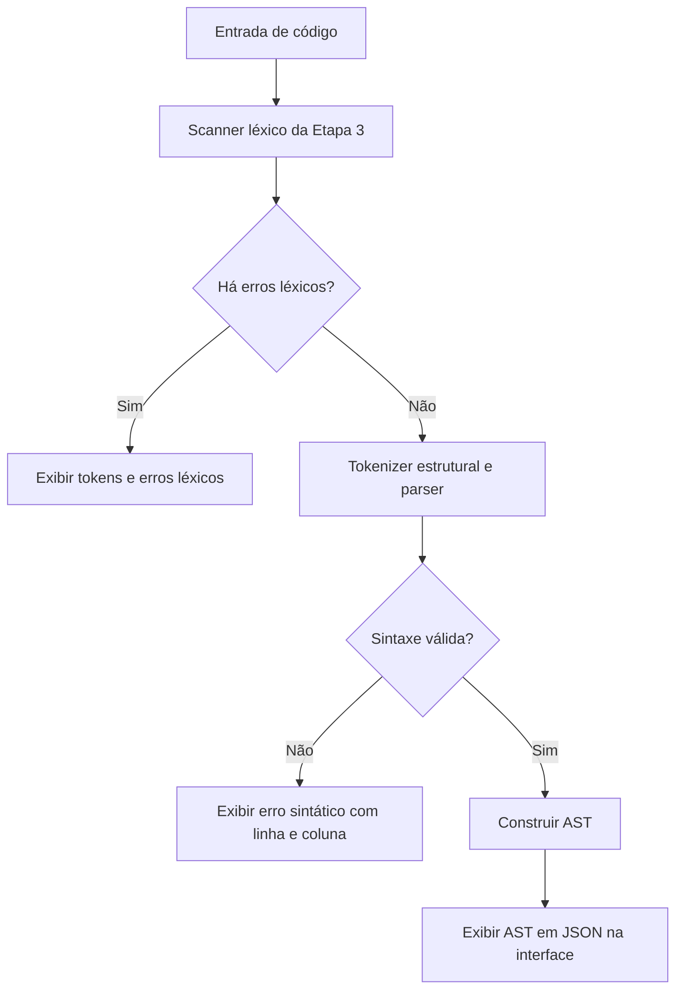

# Materiais e métodos — LexiPy Etapa 4

## Delineamento

Desenvolvimento incremental de um recurso didático para apresentar a transição entre análise léxica e análise sintática de um subconjunto de Python. A implementação mantém o scanner da Etapa 3 e adiciona parser recursivo descendente, construção de AST e diagnósticos.

## Materiais

- Python 3.12.
- FastAPI e Pydantic para a API.
- Biblioteca padrão `tokenize` para obter tokens estruturais de indentação e quebra de linha usados pelo parser.
- HTML, CSS e JavaScript para a interface.
- Docker Compose para execução integrada.
- pytest e TestClient para testes automatizados.
- GitHub Actions para integração contínua e validação automatizada.

## Procedimento

1. Revisar o escopo léxico da Etapa 3 e identificar categorias emitidas pelo scanner.
2. Definir uma gramática parcial compatível com o subconjunto didático de Python.
3. Implementar parser recursivo descendente com precedência e associatividade de operadores.
4. Definir nós da AST como objetos JSON com tipo e posição de origem.
5. Integrar scanner e parser no endpoint `POST /api/analisar`; o parser só é chamado após sucesso léxico.
6. Exibir tokens, erros e AST na interface.
7. Verificar o comportamento por testes unitários e testes de integração da API.
8. Validar configuração, build, inicialização, healthcheck, frontend, endpoint integrado e testes dentro do Docker Compose.

## Fluxo do compilador

## Critérios e casos de avaliação

Foram considerados: reconhecimento de expressões e comandos da gramática; precedência e associatividade; agrupamento e aninhamento; diagnósticos de expressão incompleta e bloco sem indentação; separação entre erro léxico e sintático; preservação do contrato anterior da API; e execução reprodutível via Docker Compose.

Os testes automatizados cobrem atribuição e precedência aritmética, condicional com alternativa e bloco indentado, laços `while` e `for`, chamadas e listas, expressão inválida, bloco sem indentação, resposta da API para código válido, erro sintático, erro léxico, entrada vazia/campo ausente e posições de tokens.

## Resultados da validação automatizada

Na execução de integração contínua registrada em [GitHub Actions — execução 43974916553](https://github.com/G2Kzin/LexiPy/actions/runs/43974916553), ambos os jobs terminaram com conclusão `success`:

- `testes-python`: instalação das dependências e execução de `pytest` concluídas com sucesso.
- `validacao-docker`: `docker compose config`, build e inicialização dos serviços, healthcheck do backend, smoke test HTTP da interface e do endpoint `POST /api/analisar`, testes dentro do container e encerramento dos serviços concluídos com sucesso.

O registro comprova a execução automatizada no ambiente do GitHub Actions. Não equivale a teste manual em navegador nem a avaliação de aprendizagem com participantes.

## Limitações e transparência

O parser cobre apenas o subconjunto documentado em `gramatica-sintatica.md`; não é uma implementação completa de Python. O scanner didático da Etapa 3 não emite NEWLINE/INDENT/DEDENT; por isso, o parser recebe o texto-fonte e usa o tokenizer padrão internamente para obter esses limites. O parser informa o primeiro erro sintático, sem recuperação de múltiplos erros. Não há execução de código, análise semântica, verificação de tipos ou geração de código.

## Referências de apoio

- ALMEIDA-MARTÍNEZ, Francisco J.; URQUIZA-FUENTES, Jaime; VELÁZQUEZ-ITURBIDE, J. Ángel. Visualization of Syntax Trees for Language Processing Courses. *Journal of Universal Computer Science*, v. 15, n. 7, p. 1546–1561, 2009. DOI: https://doi.org/10.3217/jucs-015-07-1546.
- SSANYU, Jackline; BAINOMUGISHA, Engineer; KANAGWA, Benjamin. Teaching language processing with the PAMOJA framework. *Science of Computer Programming*, v. 229, art. 102959, 2023. DOI: https://doi.org/10.1016/j.scico.2023.102959.

As referências apoiam a escolha de apresentar árvores sintáticas e o processamento de linguagens de forma explícita. Não são evidência de eficácia educacional do LexiPy; isso exigiria avaliação com participantes e método apropriado.
